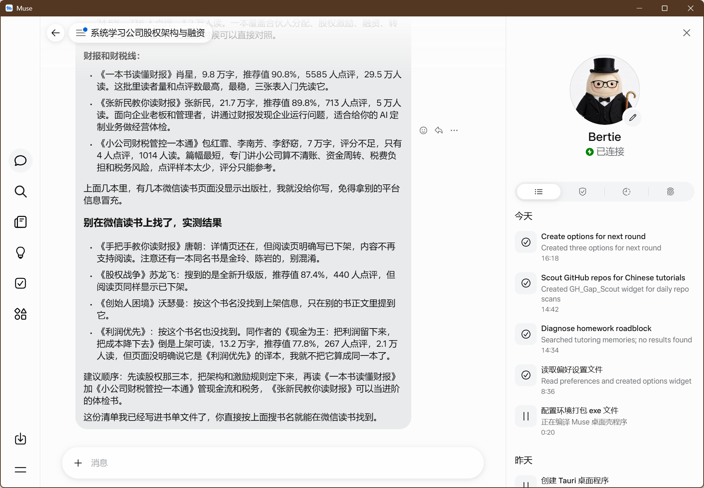

# Muse Desktop

<p align="center">
  
</p>

<p align="center">
  <strong>基于 Tauri 2 的超轻量级 Muse AI (muse.ai) 原生桌面客户端</strong>
</p>

<p align="center">
  <a href="LICENSE"></a>
  
  
  
  
</p>

---

## 📖 项目简介 (Overview)

**Muse Desktop** 是专为 **Muse**（[muse.ai](https://muse.ai)，Meta 旗下的 Personal AI Agent）打造的开源轻量级跨平台桌面客户端。

与传统 Electron 应用动辄消耗上百兆磁盘与数倍内存不同，Muse Desktop 基于 **Tauri 2** 架构构建，直接复用操作系统的原生现代 WebView 内核（Windows Edge WebView2 / macOS WKWebView / Linux WebKitGTK）。在保持原生桌面窗口体验的同时，将二进制体积缩减至惊人的 **6.8 MB**。

---

## ✨ 核心特性 (Features)

- ⚡ **极致轻量**：安装包与独立执行程序仅约 **6.8 MB**，内存占用极低，秒级极速冷启动。
- 🔑 **登录态安全持久化**：依托系统原生 WebView 数据隔离沙箱，在应用内正常登录一次后，Cookie、LocalStorage 与 Token 自动持久化保存，后续打开即用，无需重复登录。
- 🛡️ **纯净无侵入与合规**：
  - 不注入任何自动化外挂脚本，不窃取账号 Cookie，不修改目标网站 DOM。
  - 默认采用系统真实浏览器内核指纹交互，符合 Meta 官方服务协议与账户风控规范。
- 🎨 **原生桌面融合**：
  - 内置官方全套多分辨率高清图标（覆盖窗口顶栏、任务栏图标及快捷方式）。
  - 支持自适应窗口尺寸缩放、记忆窗口位置及原生系统窗口控制。
  - 支持系统托盘（System Tray）常驻与唤醒，点击关闭按钮时可提问最小化到系统托盘或退出程序，支持偏好记忆及托盘菜单重置。
- 🌐 **跨平台就绪**：基于标准 Tauri 2 工程架构，代码天然支持 Windows、macOS 和 Linux。

---

## 🖼️ 应用预览 (Preview)



---

## ⚙️ 它是如何工作的 (Architecture)

```
┌────────────────────────────────────────────────────────┐
│                   Muse Desktop 窗口                     │
│  ┌──────────────────────────────────────────────────┐  │
│  │ 系统原生 WebView (WebView2 / WKWebView / WebKit)  │  │
│  │                                                  │  │
│  │          https://muse.ai 官方在线服务             │  │
│  │                                                  │  │
│  └──────────────────────────────────────────────────┘  │
└───────────────────────────┬────────────────────────────┘
                            │
              持久化隔离沙箱 (App Data Profile)
     `com.tao.muse-desktop` 绑定的独立存储空间
     (保存 Cookies / LocalStorage / Session Token)
```

1. **零前端资源打包**：`tauri.conf.json` 直接加载 `https://muse.ai`，不内嵌繁杂的本地 Web 前端构建产物，完全跟随官方最新功能无缝迭代。
2. **独立的 Session 存储**：所有登录凭证均安全隔离保存在由应用标识符（`com.tao.muse-desktop`）绑定的系统数据目录下，不与系统主浏览器互相干扰。

---

## 🚀 快速开始 (Quick Start)

### 直接下载使用 (Pre-built Release)

前往项目的 [Releases](../../releases) 页面，下载最新的二进制文件：
- **Windows**：下载 `muse-desktop.exe` 或安装包直接双击运行。

---

### 本地编译构建 (Build from Source)

#### 前置环境要求
1. **Rust 工具链**：请先安装 [Rust 官方工具链](https://rustup.rs/)（Rust 1.77+）。
2. **Node.js**：建议 Node.js 18+ 与 npm。
3. **系统依赖**：
   - **Windows**：需具备 Microsoft Edge WebView2（Windows 10/11 通常已预装）及 C++ 生成工具。
   - **macOS**：需安装 Xcode 命令行工具 (`xcode-select --install`)。
   - **Linux** (Ubuntu/Debian 示例)：
     ```bash
     sudo apt update
     sudo apt install -y libwebkit2gtk-4.1-dev build-essential curl wget file \
       libxdo-dev libssl-dev libayatana-appindicator3-dev librsvg2-dev
     ```

#### 开发与打包命令

```bash
# 1. 克隆本仓库
git clone https://github.com/taozhuowei/muse-desktop.git
cd muse-desktop

# 2. 安装前端 CLI 依赖
npm install

# 3. 本地调试运行
npm run dev
# 或直接通过 Cargo 启动:
cd src-tauri && cargo run

# 4. 构建 Release 生产包
npm run build
# 或通过 Cargo 构建高度优化的 Release 可执行程序:
cd src-tauri && cargo build --release
```

编译产物将生成在 `src-tauri/target/release/muse-desktop.exe`。

---

## ❓ 常见问题 (FAQ)

### Q: 为什么首次打开需要登录？支持自动同步本机 Chrome 的登录态吗？
**A:** 本程序出于**账户安全与风控防范**考虑，**绝不主动探测或窃取本机 Chrome 数据库中加密的凭证**。只需在桌面端窗口中正常输入账号密码登录一次，系统 WebView 的持久化沙箱会自动妥善保存会话，之后每次开启都会保持登录状态。

### Q: 离线状态下能使用吗？
**A:** 不能。本程序是 muse.ai 官方云端智能体服务的轻量级原生桌面容器，必须在联网环境下使用。

### Q: 遇到登录风控或人机验证怎么办？
**A:** Meta 对非官方 API 或频繁变动 IP 较为敏感。Muse Desktop 默认使用系统原生无伪造的 WebView2 浏览器指纹，属于合法正常访问。建议在稳定的常规网络或固定节点下使用。

---

## 🔒 免责声明 (Disclaimer)

1. **Muse Desktop 是一个个人开源的第三方非官方桌面客户端**，与 Meta Platforms, Inc. 或 muse.ai 官方团队无任何官方附属、合作、背书或从属关系。
2. “Muse”以及相关品牌 Logo、商标与知识产权归 Meta Platforms, Inc. 及其关联实体所有。
3. 请在遵守 [Muse 服务补充条款](https://muse.ai/terms) 及相关法律法规的前提下使用本项目。

---

## 📄 开源许可证 (License)

本项目采用 [MIT 许可证](LICENSE) 完全开源。任何人均可自由学习、使用、修改与分发。
